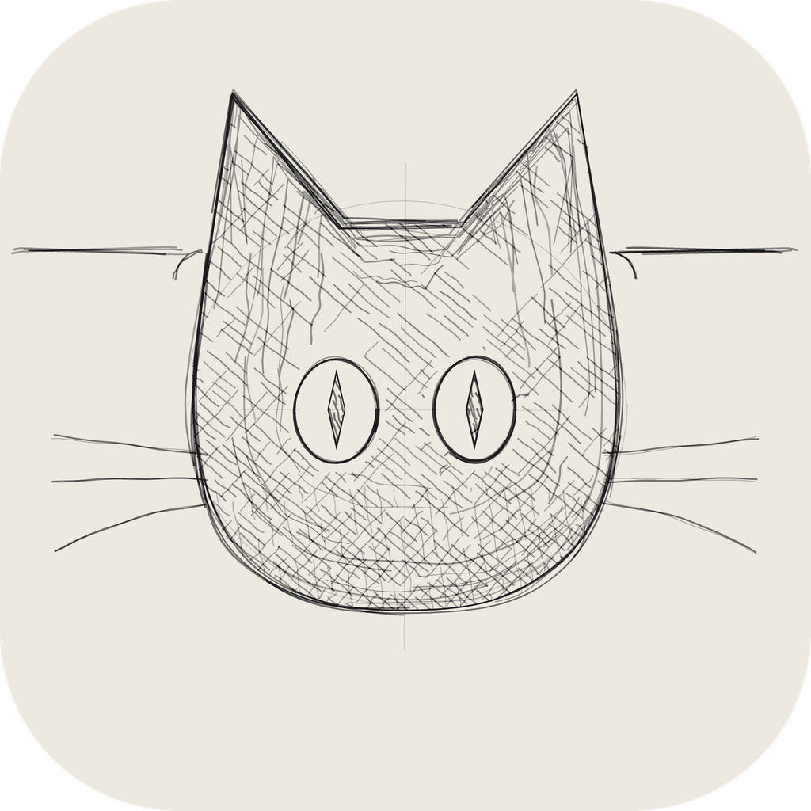
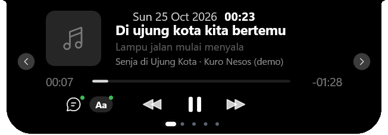
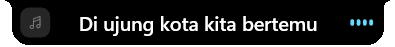
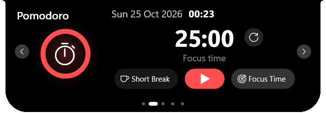
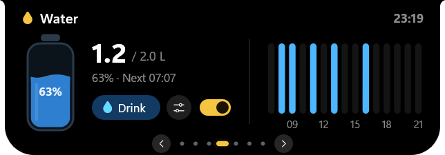
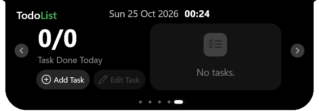
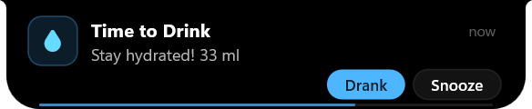
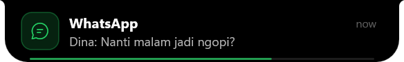
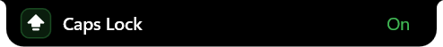

<p align="center">
  
</p>

<h1 align="center">Kuro Nesos</h1>

<p align="center">
  <b>A living notch for Windows.</b><br>
  Music with synced lyrics &amp; romaji, a focus timer, water reminder, to-do list, file shelf,
  system alerts and an idle cat mascot, all in a small black island at the edge of your screen.
</p>

<p align="center"><i>kuro</i> (黒, Japanese) = black &nbsp;·&nbsp; <i>nesos</i> (νῆσος, Greek) = island</p>

---

<p align="center">
  
</p>

<p align="center">
  
</p>

<p align="center">
  
  
</p>

<p align="center">
  
  
</p>

<p align="center">
  
  
</p>

## Features

- **Notch that lives on your screen.** A black pill hangs from the top edge and expands into a
  panel when you rest the cursor on it. Drag the panel's header to slide it along the edge or
  over to the left/right edge, where it turns vertical: a slim tab that opens into a tall panel.
- **Never in the way.** Clicks go straight through the closed notch to the window below, and
  it fades out while the cursor passes over it, so tabs and buttons underneath stay usable.
  It only opens when the cursor rests on it for a moment (or right away with `Ctrl`). Smooth spring animations,
  synced to your display's refresh rate (60/120/144 Hz).
- **Music.** Works with any player that shows up in the Windows media flyout (Spotify,
  browsers, Apple Music, ...): title, artist, album art, progress with seeking, play/pause,
  next/previous.
- **Synced lyrics** from [LRCLIB](https://lrclib.net). The collapsed notch grows and shrinks with
  each line, long lines wrap on the music page.
- **Romaji / romanization** (toggle with the `Aa` chip or the tray menu), fully offline:
  Japanese → romaji, Chinese → pinyin, Korean → Revised Romanization, Russian → BGN Latin,
  plus Greek, Thai, Arabic, ... through ICU (built into Windows).
- **Pomodoro** focus timer with short/long breaks and a progress ring.
- **Water reminder**: daily goal, bottle size and active hours, reminders spread over the day,
  hourly chart, "Drank / Refilled / Snooze" right from the notification.
- **To-do list** with optional time ranges; a "Task Time!" alert when a task starts.
- **File shelf**: drop files, browser images or links onto the notch, click to open, drag them
  back out to any app.
- **Alerts**: Caps Lock, charger plugged/unplugged, low battery, Wi-Fi/Ethernet changes,
  Bluetooth devices, keyboard layout, and mirrored Windows notifications.
- **Kuro the cat**: after 15 s without input the notch turns into a little black neko that
  naps (ears, whiskers, paws over the edge, a swishing tail and drifting "z"s), opens its
  amber eyes and follows your cursor when you come back, then waves hello.
- **Smooth everywhere**: spring-animated shape, cross-fading views, and every control eases
  its hover highlight, squeezes a little when clicked, and animates switches and checks.
- **Polite**: hides while a fullscreen app (game, video) is in front, rebuilds its renderer
  after a GPU reset, uses about 10-20 MB of RAM and ~2 % of one CPU core when idle.

## Install

Grab `kuro-nesos.exe` from the [Releases](https://github.com/SieghartSaladdin/kuro-nesos/releases)
page (when available) or build it yourself. It is a single portable executable; run it and the
notch appears. Right-click the tray icon for options and *Start with Windows*.

### Requirements

- Windows 10 1903+ or Windows 11 (64-bit)
- For **kanji → romaji**: the Japanese language feature
  (*Settings → Time & language → Language & region → Add a language → Japanese*; it does not
  have to be your display language). Without it, lines containing kanji are shown in their
  original script; kana-only lines and all other scripts are still romanized.

### Build from source

1. Install [Rust](https://rustup.rs) (stable, MSVC toolchain) and the
   *Visual Studio Build Tools* with the "Desktop development with C++" components
   (MSVC + Windows SDK).
2. Build:

   ```bash
   cargo build --release
   ```

   The binary is `target/release/kuro-nesos.exe`.

## Usage

| Where | What |
|---|---|
| Rest the cursor on the notch (or hold `Ctrl`) | expand it; move away to collapse |
| Drag the panel header | move the notch along the edge or to the left/right/top edge |
| `‹` `›`, the dots, or the mouse wheel | switch page (Music, Pomodoro, Water, Shelf, To-do) |
| Lyrics bubble / `Aa` chip on the music page | lyrics on/off, romaji on/off |
| Tray icon (right-click) | Start with Windows, Mascot, Minimal notch, Romaji lyrics, Reset position, About, Exit |
| To-do form | type the title, `Tab` to the time field (`HHMM HHMM`), `Enter` saves, `Esc` cancels |

### Command-line flags (testing)

```
--demo alerts|lyrics|mascot|all   fake notifications / fake song with lyrics / fast mascot
--pin                              keep the notch expanded
--page N                           start on page N (0 = Music ... 4 = To-do)
--test-lyrics "Title|Artist"       fetch lyrics once, write the result to the log, exit
--test-roman "line|line"           romanize lines, write the result to the log, exit
--test-media                       log the current media session, exit
```

Set `KURO_DEBUG_FPS=1` to log the render frame rate.

## Privacy

- **Online:** only the lyrics search. The track title and artist are sent to
  `lrclib.net`. Nothing else leaves your PC; romanization is offline.
- **Notifications:** mirroring Windows notifications needs your consent (Windows asks once).
  Their text is only shown in the notch, never stored.
- **Local data:** settings, water log and to-do list in `%APPDATA%\KuroNesos`, shelf items and a
  small log in `%LOCALAPPDATA%\KuroNesos`.

## How it is built

Rust with the [`windows`](https://github.com/microsoft/windows-rs) crate, no UI framework:

| File | Role |
|---|---|
| `src/main.rs` | window, frame loop paced by the compositor, tray, command line |
| `src/gfx.rs` | Direct3D 11 → DXGI swap chain → DirectComposition, drawn with Direct2D + DirectWrite |
| `src/ui/` | notch state machine (`mod.rs`), animations (`anim.rs`), input, painting, pages, vertical layouts, music, alerts, mascot, window helpers |
| `src/media.rs` | Global System Media Transport Controls (title, art, timeline, commands) |
| `src/lyrics.rs`, `src/json.rs` | LRCLIB client, LRC parser, minimal JSON reader |
| `src/roman.rs` | romanization (ICU transliterator, Japanese reading analyzer, Hangul RR) |
| `src/sys.rs` | battery, network, Bluetooth, notifications, keyboard layout, fullscreen detection, chime |
| `src/model.rs`, `src/shelf.rs` | settings, water, to-do, shelf storage and OLE drag & drop |

The logo is drawn by code: `python assets/make_logo.py` (needs Pillow) regenerates
`assets/logo.png` and the app icon `assets/kuro-nesos.ico`.

Contributor notes (module map, conventions, frame pacing and memory budget) are in
[AGENTS.md](AGENTS.md).

## Credits

- Synced lyrics: [LRCLIB](https://lrclib.net).
- Icons: Segoe Fluent Icons (shipped with Windows).

## License

[MIT](LICENSE)
