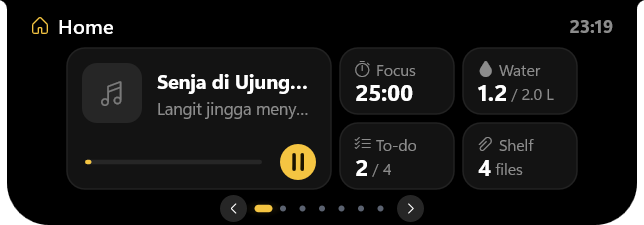
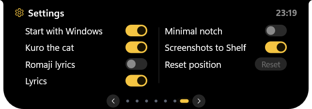
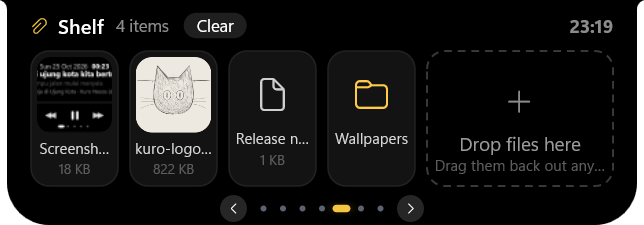

<p align="center">
  
</p>

<h1 align="center">Kuro Nesos</h1>

<p align="center">
  <b>A living notch for Windows.</b><br>
  Music with synced lyrics and a beat equalizer, a focus timer, water reminder, to-do list,
  file shelf and system alerts, all in a small black island at the edge of your screen,
  looked after by an idle black cat.
</p>

<p align="center"><i>kuro</i> (黒, Japanese) = black &nbsp;·&nbsp; <i>nesos</i> (νῆσος, Greek) = island</p>

<p align="center">
  <a href="https://github.com/SieghartSaladdin/kuro-nesos/releases/latest"></a>
  
  
  <a href="LICENSE"></a>
</p>

<p align="center">
  
</p>
<p align="center">
  
</p>

<p align="center">
  <a href="#features">Features</a> ·
  <a href="#install">Install</a> ·
  <a href="#usage">Usage</a> ·
  <a href="#privacy">Privacy</a> ·
  <a href="#build-from-source">Build from source</a> ·
  <a href="#how-it-is-built">How it is built</a> ·
  <a href="#contributing">Contributing</a>
</p>

---

## Features

### Music

- **Any player** that shows up in the Windows media flyout (Spotify, browsers, Apple Music, ...):
  title, artist, album art, seeking, play/pause, next/previous.
- **Synced lyrics** from [LRCLIB](https://lrclib.net). The collapsed notch grows and shrinks with
  each line; instrumental breaks show a note icon.
- **Romanization**, offline: Japanese → romaji (kanji included), Chinese → pinyin, Korean →
  Revised Romanization, Russian, Greek, Thai, Arabic and more. Toggle it with the `Aa` chip.
- **Equalizer that follows the beat**: 11 amber bars mirrored around the centre, bass in the
  middle and treble at the ends, moving with six frequency bands of what you hear. With lyrics
  off the pill shrinks to just the cover and the equalizer.

### Home and Settings

<p align="center">
  
  
</p>

- **Home** shows music, focus timer, water, to-do and shelf at a glance; every tile opens its page.
- **Settings** live right in the panel: start with Windows, the cat, lyrics, romaji, minimal
  notch, screenshots to shelf and reset position.

### Focus, water, to-do and shelf

<p align="center">
  
  
</p>
<p align="center">
  
  
</p>

- **Pomodoro**: focus, short and long breaks with a progress ring.
- **Water reminder**: daily goal, bottle size and active hours, reminders spread over the day,
  an hourly chart, and *Drank / Snooze* right from the alert.
- **To-do list** with optional time ranges and a *Task Time!* alert when a task starts.
- **File shelf**: drop files, browser images or links on the notch, click to open, drag them
  back out to any app. New screenshots (Win+PrtScn, Snipping Tool) land here by themselves with
  a thumbnail; remove one with its × or everything with *Clear*.

### Alerts

<p align="center">
  
  
</p>
<p align="center">
  
</p>

Caps Lock, charger and low battery, Wi-Fi/Ethernet, Bluetooth devices, keyboard layout, and
mirrored Windows notifications (WhatsApp, Discord, mail, ...).

### Kuro the cat

After 15 s without input the notch turns into a little black neko that naps, with ears,
whiskers, paws over the edge, a swishing tail and drifting "z"s. It opens its amber eyes and
follows your cursor when you come back, then waves hello.

### Stays out of your way

- Clicks go straight through the closed notch, and it fades while the cursor passes over it.
  It only opens when the cursor rests on it (or right away with `Ctrl`).
- Dock it at the top, or drag it to the left or right edge, where it turns into a slim tab.
- Hides while a fullscreen app (game, video) is in front.
- Spring animations synced to your display (60/120/144 Hz); about 10–20 MB of RAM and ~2 % of one
  CPU core when idle.

## Install

Download from the [latest release](https://github.com/SieghartSaladdin/kuro-nesos/releases/latest):

| File | What it is |
|---|---|
| `KuroNesos-<version>-Setup.exe` | **Installer** for your user only (no admin). Start Menu entry, optional start with Windows, clean uninstall from *Settings → Apps*. |
| `KuroNesos-<version>-portable.zip` | **Portable**: unzip anywhere, even a USB stick. Data stays in `KuroNesosData` next to the exe. |
| `kuro-nesos.exe` | **Single file**; data goes to `%APPDATA%\KuroNesos`. |

Windows SmartScreen may warn about an unrecognised app because the exe is not code-signed yet:
choose *More info → Run anyway*.

**Requirements:** Windows 10 1903+ or Windows 11, 64-bit. Kanji → romaji uses Windows' Japanese
reading data when it is installed; otherwise a 16 MB dictionary (IPADIC) is downloaded once, the
first time a song has kanji.

## Usage

| Where | What |
|---|---|
| Rest the cursor on the notch (or hold `Ctrl`) | expand it; move away to collapse |
| Drag the panel header | move the notch along the edge, or to the left/right/top edge |
| `‹` `›`, the dots or the mouse wheel | switch page: Home, Music, Pomodoro, Water, Shelf, To-do, Settings |
| Home tiles | open that page; play/pause right from Home |
| Lyrics bubble / `Aa` chip on the music page | lyrics on/off, romaji on/off |
| Tray icon (right-click) | Start with Windows, Mascot, Minimal notch, Romaji lyrics, Reset position, About, Exit |
| To-do form | type the title, `Tab` to the time (`HHMM HHMM`), `Enter` saves, `Esc` cancels |

<details>
<summary>Command-line flags for testing</summary>

```
--demo alerts|lyrics|mascot|all   fake notifications / fake song with lyrics / fast mascot
--pin                              keep the notch expanded
--page N                           start on page N (0 Home, 1 Music ... 5 To-do, 6 Settings)
--test-lyrics "Title|Artist"       fetch lyrics once, write the result to the log, exit
--test-roman "line|line"           romanize lines, write the result to the log, exit
--test-media                       log the current media session, exit
```

Set `KURO_DEBUG_FPS=1` to log the render frame rate.
</details>

## Privacy

- **Online:** only the lyrics search (title and artist go to `lrclib.net`) and, on PCs without
  Japanese reading data, a one-time dictionary download from this project's releases.
- **Audio:** while music plays the equalizer measures the loudness of what your speakers play,
  per frequency band, in memory. Nothing is recorded, stored or sent.
- **Notifications:** mirroring needs your consent (Windows asks once); their text is only shown,
  never stored.
- **Screenshots** are only linked on the shelf, never copied or uploaded.
- **Local data:** settings, water and to-do in `%APPDATA%\KuroNesos`; shelf items and a small log
  in `%LOCALAPPDATA%\KuroNesos`.

## Build from source

1. Install [Rust](https://rustup.rs) (stable, MSVC toolchain) and the *Visual Studio Build Tools*
   with "Desktop development with C++" (MSVC + Windows SDK).
2. Build:

   ```bash
   cargo build --release
   ```

   The app is `target/release/kuro-nesos.exe`.
3. Optional, the release packages: with [Inno Setup 6](https://jrsoftware.org/isinfo.php)
   installed, `installer/build.ps1` writes the installer, the portable zip and the exe to `dist/`.

## How it is built

Rust with the [`windows`](https://github.com/microsoft/windows-rs) crate and no UI framework.

| File | Role |
|---|---|
| `src/main.rs` | window, frame loop paced by the compositor, tray, command line |
| `src/gfx.rs` | Direct3D 11 → DXGI swap chain → DirectComposition, drawn with Direct2D + DirectWrite |
| `src/ui/` | notch state machine, animations, input, painting, pages, vertical layouts, music, alerts, mascot |
| `src/media.rs` | Windows media session (title, art, timeline, commands) |
| `src/audio.rs` | equalizer: WASAPI loopback split into six bands, beat detection |
| `src/lyrics.rs`, `src/json.rs` | LRCLIB client, LRC parser, minimal JSON reader |
| `src/roman.rs`, `src/jdict.rs` | romanization (ICU, Japanese reading analyzer, IPADIC kanji reader, Hangul) |
| `src/sys.rs` | battery, network, Bluetooth, notifications, screenshots folder, keyboard layout, fullscreen detection |
| `src/model.rs`, `src/shelf.rs` | settings, water, to-do, shelf storage, drag and drop, portable mode |
| `installer/` | Inno Setup script, portable marker and `build.ps1` |

The logo is drawn by code: `python assets/make_logo.py` (needs Pillow) regenerates
`assets/logo.png` and the app icon.

## Contributing

Bug reports, ideas and pull requests are welcome. Read [CONTRIBUTING.md](CONTRIBUTING.md) for
setup and conventions, [AGENTS.md](AGENTS.md) for the module map, and the
[Code of Conduct](CODE_OF_CONDUCT.md).

## Credits

- Synced lyrics: [LRCLIB](https://lrclib.net).
- Kanji readings: [IPADIC](https://github.com/taku910/mecab) (mecab-ipadic-2.7.0), © 2000–2003 Nara
  Institute of Science and Technology; built with `tools/make_ja_dict.py` and published as the
  `ja-dict-1` release.
- Icons: Segoe Fluent Icons (shipped with Windows).

## License

[MIT](LICENSE)
